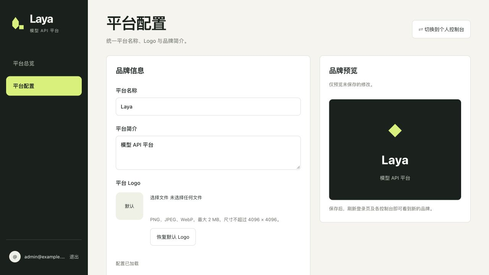

# Laya

[简体中文](README.md) | [English](README.en.md)

A self-hosted platform for model APIs, API key management, and token billing. Supports local Laya models and external OpenAI-compatible chat endpoints, with email/password login, usage and cost reports, an admin dashboard, branding settings, and user management.



## Per-user request limits

Disabled by default. All API keys belonging to one user share the same limits across the three inference endpoints. To enable them:

```bash
LAYA_USER_RPM=60 LAYA_USER_MAX_INFLIGHT=1 zsh run-api
```

For Docker, set these variables in your private `.env.deploy` and recreate the application container. Never commit real passwords.

- `LAYA_USER_RPM`: 0–100000; `LAYA_USER_MAX_INFLIGHT`: 0–1024. Zero disables the corresponding limit; invalid values prevent startup.
- RPM uses fixed UTC minute windows stored in MySQL, not a rolling 60-second window. Requests near a minute boundary can briefly reach twice the configured budget.
- Admission consumes one RPM slot, even if inference or accounting later fails. Invalid input, failed authentication, unavailable model configuration, and rate-limit rejections do not consume a slot.
- In-flight slots cover queueing, execution, and settlement. A single process and worker are still required; this does not increase model parallelism.
- Limits return HTTP 429 with `Retry-After` and `rate_limit_exceeded` or `concurrency_limit_exceeded`. Counter storage failures return HTTP 503 with `rate_limit_unavailable`.
- Rejected requests create no call or charge records. RPM counts survive restarts within the same minute; in-flight counts reset when the process restarts.
- Only temporary windows older than 24 hours are cleaned up, never billing history. These limits are **not hard token quotas**.

To disable limits, set both values to zero and restart. Stop using the new code before manually rolling back migration `0009`.

## Docker deployment

Requires Docker Engine and Compose v2. Containers support external-model mode only.
Copy `.env.example` to `.env.deploy`, configure database passwords, and optionally change the application port.

```bash
cp .env.example .env.deploy
# Edit .env.deploy before running:
docker compose --env-file .env.deploy up -d --build --wait --wait-timeout 180
docker compose --env-file .env.deploy exec app python -m app.manage migrate
docker compose --env-file .env.deploy exec app python -m app.manage init-admin --email YOUR_EMAIL
```

Enter the administrator password interactively. Open `http://127.0.0.1:APP_PORT/login` and configure the upstream model in the admin settings.
The default deployment is accessible only from the host machine. Do not overwrite an existing `.env` with `.env.deploy`.

## Local development

Requires MySQL, a Python virtual environment, and Node.js. Store database credentials in `.env`.

```bash
uv pip install --python .venv/bin/python -r requirements-api.txt
npm --prefix frontend ci
npm --prefix frontend run build
LAYA_RUNTIME=external zsh run-api
```

In another terminal, run `npm --prefix frontend run dev` to serve the independent frontend and proxy API requests.

To use an already installed and cached local Laya model, run `zsh run-api` instead.
Local login: `http://127.0.0.1:5173/login`. API documentation: `http://127.0.0.1:8000/docs`.
Docker uses a separate Nginx frontend on `APP_PORT`; the Python API image contains no pages.

## Verification

```bash
PYTHONPATH=backend .venv/bin/python -m unittest discover -s backend/tests
npm --prefix frontend run build
npm --prefix frontend test
```

## Documentation

The detailed project documents below are currently in Chinese:

- [Backend ORM layering and verification](docs/20261019-ORM分层-设计.md): models, repositories, services, and transaction ownership.
- [User guide](docs/使用指南.md): configuration, deployment, administrator initialization, and API examples.
- [Platform requirements](docs/20261002-Laya平台-需求.md) · [Self-hosting implementation plan](docs/20261008-自部署平台-任务.md)
- [Development instructions](AGENTS.md) · [Project knowledge](docs/PROJECT_KNOWLEDGE.md)
