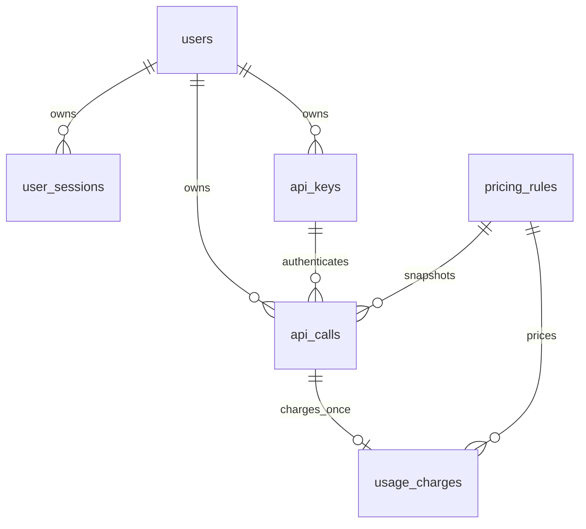
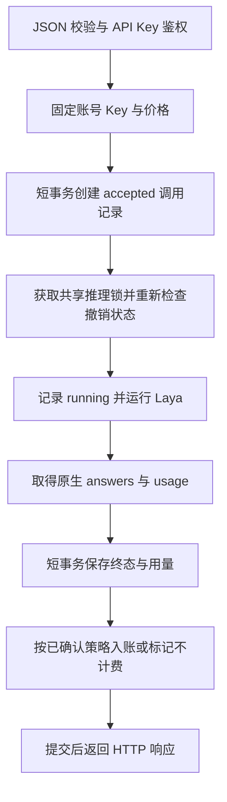

# Laya 平台设计：数据与代码架构

创建日期：2026-10-02。状态：设计提案；首版（Key、鉴权、生命周期、计费、统计与页面）
已于 2026-10-02 按本文实施，实施采用值与偏差见
[任务文档 D1–D12 与 §7](20261002-Laya平台-任务.md)。
依据：[平台需求](20261002-Laya平台-需求.md)及 [页面设计](design/README.md)。
本文设计数据与代码架构；API 路径为提案，部署与未确认业务策略仍待确定。
本次不实现业务代码或执行迁移。

## 1. 范围与选型

第一版建议使用六张关系表：users、user_sessions、api_keys、pricing_rules、
api_calls、usage_charges。调用记录与费用记录分开：失败/处理中调用也需要统计，
但是否产生费用必须由明确的计费策略决定。

数据库尚未选定，本文采用逻辑类型：UUID、整数、精确十进制、文本、布尔、UTC 时间。
数据库确定后再生成对应方言 DDL、迁移和回滚脚本；不默认项目已经使用 PostgreSQL。
除表中明确可空字段外，字段均 NOT NULL；所有表都有主键。
ID 建议由应用生成 UUID，时间统一存 UTC，页面时区和日期过滤边界待确认。

## 2. 关系



api_calls 同时存 user_id 和 api_key_id，方便租户隔离；用复合外键保证二者归属一致。
usage_charges 不重复存 user_id/api_key_id，归属通过 api_calls 取得，避免账务归属漂移。

## 3. users：邮箱账号

| 字段 | 逻辑类型 | 说明 |
| --- | --- | --- |
| id | UUID | 主键 |
| email | 文本(254) | 用于展示的邮箱 |
| email_normalized | 文本(254) | 唯一登录标识；规范化规则在实现前固定 |
| password_hash | 文本(255) | 推荐 Argon2id 自描述哈希，含盐与算法参数 |
| status | 文本(16) | active / disabled |
| last_login_at | UTC 时间，可空 | 最近登录 |
| created_at | UTC 时间 | 创建时间 |
| updated_at | UTC 时间 | 最近修改 |

索引：UNIQUE(email_normalized)。邮箱大小写规则需统一，不能擅自合并点号或加号别名。
不存明文密码、角色、余额或邮箱验证码；邮箱验证/管理员角色等未确定后再扩展。
密码修改与禁用账号时，建议撤销已有会话；是否同时撤销 Key 需明确策略。
历史账单存在时禁止级联删除用户，删除/匿名化与保留期限另行设计。

## 4. user_sessions：登录会话

建议随机不透明会话 Token + 服务端会话表，支持立即退出与撤销；这是设计建议，
不是已确认的 JWT/登录 API 契约。

| 字段 | 逻辑类型 | 说明 |
| --- | --- | --- |
| id | UUID | 主键 |
| user_id | UUID | 外键 users.id |
| token_hash | 文本(64) | 高熵随机会话 Token 的 SHA-256，唯一 |
| created_at | UTC 时间 | 登录创建时间 |
| expires_at | UTC 时间 | 绝对过期时间 |
| revoked_at | UTC 时间，可空 | 撤销时间 |

索引：UNIQUE(token_hash)、(user_id, revoked_at)、(expires_at)。
有效条件：未撤销、未过期、所属用户 active。会话秘密不存明文，不写日志。
网页登录建议 Secure/HttpOnly Cookie，Cookie/CSRF/SameSite 策略在 API 设计阶段确定。
登录暴力防护不可只靠此表：按账号和来源限速，还需选定跨进程计数机制与阈值。

## 5. api_keys：模型调用密钥

| 字段 | 逻辑类型 | 说明 |
| --- | --- | --- |
| id | UUID | 主键 |
| user_id | UUID | 外键 users.id |
| name | 文本(60) | 展示用名称，可空串表示未命名；2026-10-03 用户确认新增，不参与认证与归属 |
| key_hash | 文本(64) | 高熵随机 Key 的 SHA-256，唯一 |
| display_prefix | 文本(32) | 非秘密公开前缀用于识别 |
| last_four | 文本(4) | 脱敏展示后缀，不能用于认证 |
| created_at | UTC 时间 | 创建时间 |
| last_used_at | UTC 时间，可空 | 最近一次通过鉴权的调用时间 |
| revoked_at | UTC 时间，可空 | 撤销时间；不物理删除 |

索引：UNIQUE(key_hash)、UNIQUE(id, user_id)、(user_id, created_at, id)。
状态由 revoked_at 推导，避免状态与时间矛盾。Key 秘密至少 256 位随机熵，
完整值只在创建响应中返回一次；密码需慢哈希，而高熵随机 Key 可用 SHA-256 校验。
key_hash 不通过管理 API 返回。到期、轮换、权限 scope 和数量上限未确定，暂不加列；
命名已按 2026-10-03 用户要求加入 name 列，仍不提供改名接口。
撤销后新请求拒绝；已通过鉴权的在途请求是否终止需在接口设计中说明。

## 6. pricing_rules：不可变价格版本

| 字段 | 逻辑类型 | 说明 |
| --- | --- | --- |
| id | UUID | 主键 |
| version | 文本(32) | 唯一版本标识，例如 v1 |
| model | 文本(64) | 第一版 multilingual |
| currency | 文本(3) | 第一版 CNY |
| token_basis | 文本(32) | laya_usage_input_tokens |
| unit_tokens | 正整数 | 第一版 1000000 |
| unit_price_yuan | DECIMAL(20,6) | 第一版 1.000000 |
| billing_policy_version | 文本(32) | 成败/断连计费策略版本，待确定后才可发布 |
| effective_from | UTC 时间 | 生效起点 |
| created_at | UTC 时间 | 记录创建时间 |

索引：UNIQUE(version)、UNIQUE(model, effective_from)。约束 unit_tokens > 0、价格 ≥0。
仅追加新价格；禁止更新已被引用记录，不通过修改旧价格重算历史费用。
按模型、请求接受时间取最新 effective_from ≤ 时间的规则并固定该规则 ID。
无适用规则时不得静默零价调用。是否允许定时价格切换不是本期页面需求。
扩展币种、折扣和输出计价前需单独需求及金额精度评估。

## 7. api_calls：调用明细与生命周期

| 字段 | 逻辑类型 | 说明 |
| --- | --- | --- |
| id | UUID | 服务端请求标识/主键；同一调用内部重试写入时复用 |
| user_id | UUID | 外键 users.id |
| api_key_id | UUID | 与 user_id 构成复合外键到 api_keys(id, user_id) |
| endpoint | 文本(128) | 固定路由标识，不存含秘密的完整 URL |
| model | 文本(64) | 使用模型 |
| model_revision | 文本(128)，可空 | 实际加载版本未知时留空，不伪造 |
| pricing_rule_id | UUID | 外键 pricing_rules.id，请求接受时固定 |
| status | 文本(24) | accepted / running / succeeded / failed / interrupted |
| http_status | 整数，可空 | 服务端处理响应状态，非客户端收到响应的证明 |
| error_code | 文本(64)，可空 | 受控错误分类，不保存异常原文或输入 |
| started_at | UTC 时间 | 已鉴权调用接收时间，包含排队起点 |
| completed_at | UTC 时间，可空 | 处理结束时间 |
| duration_ms | 非负整数，可空 | 使用单调时钟测量整体处理时间 |
| input_tokens | 非负整数，可空 | Laya 实际报告；未知不得填 0 |
| output_tokens | 非负整数，可空 | 当前已完成推理为 0；未取得用量则为空 |
| truncated | 布尔，可空 | Laya 实际截断标记 |
| state_tokens_dropped | 非负整数，可空 | 实際报告的截断量 |
| billing_status | 文本(16) | pending / charged / not_billable |
| billing_reason | 文本(64)，可空 | 策略判定或待处理原因 |
| created_at | UTC 时间 | 记录时间 |
| updated_at | UTC 时间 | 最近生命周期更新时间 |

索引建议：(user_id, started_at, id)、(user_id, api_key_id, started_at, id)、
(user_id, endpoint, started_at, id)、(billing_status, started_at)。
按真实查询与 EXPLAIN 决定是否保留所有索引，不预先为每个字段建索引。
状态非 accepted/running 才允许 completed_at；succeeded 必须具备用量与完成时间。
若存在记录失败/断连，应保留已知用量，不能默认所有失败用量都是 0。
拒绝未知/撤销 Key 的调用不写本表，避免无法证明归属的数据污染用户统计。
不保存输入正文、密码、完整 Key、来源 IP 或 User-Agent；后两项安全审计需求另定。

## 8. usage_charges：不可变费用明细

| 字段 | 逻辑类型 | 说明 |
| --- | --- | --- |
| id | UUID | 主键 |
| call_id | UUID | UNIQUE，外键 api_calls.id，一次调用最多一笔费用 |
| pricing_rule_id | UUID | 外键 pricing_rules.id，与调用固定价格一致 |
| billable_input_tokens | 非负整数 | 本笔已决定可计费用量 |
| unit_tokens | 正整数 | 价格快照，第一版 1000000 |
| unit_price_yuan | DECIMAL(20,6) | 价格快照，第一版 1.000000 |
| amount_yuan | DECIMAL(20,6) | 精确人民币原值；非实际付款记录 |
| currency | 文本(3) | CNY |
| created_at | UTC 时间 | 记账时间 |

索引：UNIQUE(call_id)、(created_at, id)。约束用量/费用非负、unit_tokens >0。
当前 1 Token =0.000001 元，因此六位小数能精确表示当前价格。
计算使用 Decimal：billable_input_tokens × unit_price_yuan ÷ unit_tokens；
当前价格不会有额外舍入。未来价格产生更多小数时，必须先确定精度及舍入规则。
快照与规则一致性、金额算式和调用价格一致性由记账事务校验；选定数据库后评估
用复合约束或触发器进一步保护，不能声称单一外键已验证全部关系。
记录一旦入账不可直接修改/删除，修正与退款需后续独立调整流水设计。
没有费用行不等于免费：必须读取 api_calls.billing_status 区分 pending 和 not_billable。

## 9. 一致性、恢复与统计

建议处理顺序：鉴权 → 固定价格/持久化 accepted → 短事务结束 → 模型推理 →
短事务内更新终态及 usage、决定计费资格、插入费用并更新 billing_status → 返回。
不能持有数据库事务等待 MPS 推理；不允许只写 succeeded 而丢失费用状态。
pending/accepted/running 遗留记录用于恢复巡检，服务异常不能默认为免费或成功。
若推理完成但最终事务失败，返回方式、用量恢复来源与补偿机制仍需完整设计；
仅靠这六张表不能保证进程崩溃时恢复尚未持久化的模型用量。

UNIQUE(call_id) 防止同一调用重复记账，但不提供客户端重试去重或 exactly-once 推理。
客户端重试是否按新调用计费、是否引入 Idempotency-Key、作用域与保留期限待确认，
不提前新增形同虚设的幂等列。并发记账以唯一约束和事务为最终保护。

当前无需汇总表：按租户与 UTC 半开区间 [from,to) 聚合调用和费用明细。
成功/失败统计不包含 accepted/running；处理中数可单独返回。
费用 SUM(usage_charges.amount_yuan)，Token 区分实际用量和计费用量；pending 单列，
不能把未完成账务的范围显示为最终结算金额。列表用 (started_at,id) 稳定排序。
数据库查询必须带认证用户范围，不能只凭客户端提交的 user_id/api_key_id 查询。
每日汇总、分区和缓存只有数据量与性能证据支持时再增加。

## 10. 迁移、验证与待确认

迁移建议按 users → sessions/keys/pricing → calls → charges 创建；约束和索引同迁移。
无现有 DB，因此不存在已执行迁移；数据库类型、部署与备份先确认，再生成可审查 SQL。
生产有数据后的回滚优先恢复兼容代码，禁止直接 DROP 账单表；保留期限另定。

验证至少覆盖：邮箱唯一性、Token 哈希查询、跨用户复合外键、撤销后拒绝调用、
同 call 两次并发入账只保留一笔、未知用量与 0 区别、精确小额累计、历史价格不可变、
调用终态与费用状态事务一致，以及遗留处理中记录恢复。
数据库未选定，本次不声称完成 SQL 方言、迁移执行或持久化集成测试。

待确认：数据库类型；账号来源；失败/断连计费政策；重复请求政策；仅费用统计还是扣款；
会话有效期及登录限速；统计时区、展示/结算精度、记录保留与恢复补偿。
未加入验证码、充值订单、钱包、支付流水及管理员角色表，避免擅自扩展已确认范围。

## 11. 代码组织

采用单个 FastAPI 应用、关系数据库和一个 Laya 模型实例。管理与推理共用后端，
不引入微服务、Redis、消息队列或后台任务系统；后续有真实容量需求再评估。
采用常见的前后端同仓布局，后端代码收敛到 backend/app，按职责组织。
不再把所有模块放在根目录；目录按实际实现建立，不提前创建空模块。

下列是目标结构（首版已按此创建，实际文件名差异见任务 §7.2 的 D12 与 §7.3）；
根目录现有脚本和 docs 继续保留。

```text
.
├── backend/
│   ├── app/
│   │   ├── __init__.py
│   │   ├── main.py                  FastAPI 组装、lifespan
│   │   ├── api/
│   │   │   ├── dependencies.py      会话/Key 认证与请求级依赖
│   │   │   └── v1/
│   │   │       ├── auth.py          登录、退出、当前用户
│   │   │       ├── api_keys.py      申请、列表、撤销
│   │   │       ├── inference.py     两个现有推理接口
│   │   │       └── statistics.py    调用/费用查询
│   │   ├── core/
│   │   │   ├── config.py            环境配置
│   │   │   └── security.py          密码/秘密哈希与验证
│   │   ├── db/
│   │   │   ├── session.py           连接与短事务
│   │   │   └── models.py            六张表映射与约束
│   │   ├── schemas/
│   │   │   ├── auth.py
│   │   │   ├── api_keys.py
│   │   │   ├── inference.py
│   │   │   └── statistics.py        Pydantic 请求/响应契约
│   │   └── services/
│   │       ├── accounts.py          账号/会话操作
│   │       ├── api_keys.py          Key 生命周期
│   │       ├── model_runtime.py     Laya 单实例与原生 usage
│   │       ├── customer_service.py  现有客服分流规则
│   │       ├── inference.py         调用生命周期协调
│   │       ├── billing.py           精确计费与唯一入账
│   │       └── statistics.py        租户范围下的查询与聚合
│   ├── migrations/                 选定迁移工具后建立
│   ├── tests/                      单元/集成/契约测试
│   └── pyproject.toml              完整依赖及工具配置，待实施
├── frontend/
│   ├── src/
│   │   ├── pages/                  登录、Key、调用、费用页面
│   │   ├── components/             表格、筛选器、布局等复用组件
│   │   ├── api/                    后端调用封装
│   │   └── styles/                 Tailwind 入口与主题
│   └── package.json               前端框架与构建工具待确认
├── scripts/                        启动器、客服 CLI 与操作脚本
├── docs/                           现有文档及 design，保持原结构
├── AGENTS.md
├── README.md
└── .gitignore
```

不为每张表再建 Service/Repository 文件，不建 generic base CRUD 或无逻辑转发层。
schemas 按业务接口分组，不为每个字段建独立文件。db/models.py 初期集中表定义，
只有内容明显膨胀后再拆；不额外创建 Repository 层。
ORM、迁移工具、前端框架和数据库驱动需在技术选型后记录依赖及版本，不作为已安装事实。

## 12. 职责与依赖方向

| 模块 | 负责 | 不承担 |
| --- | --- | --- |
| api.py | 组装与启动、注册 HTTP 路由 | 费用公式和用户查询 |
| settings.py | 缓存路径、设备、DB、会话/安全参数校验 | 请求输入与秘密日志 |
| database.py / models.py | 持久化连接、表约束 | HTTP 状态码或模型推理 |
| auth.py | 凭据校验、账号状态、认证上下文 | 客户端传入的归属认定 |
| *_api.py | Pydantic 校验、鉴权依赖、HTTP 错误映射 | 逐请求加载模型 |
| model_runtime.py | 模型生命周期与返回原生 answers/usage | 登录与计费政策 |
| inference.py | 单次调用全过程与短事务协调 | 公共 HTTP 响应定义 |
| billing.py | 固定价格、精确费用、唯一入账 | 支付扣款或推理重试 |
| stats_api.py | 租户范围下的明细/聚合查询 | 以图表缓存作为账务事实 |

依赖方向：API → auth / inference / billing / database；inference → model_runtime、
billing、database；auth / billing → database / models；模型模块不反向导入 API。
上表模块名为职责简称，实际路径按第 11 节目录，例如 api.py 迁移至 app/main.py。
main.py 注入运行时和 DB 连接工厂，不由底层模块 import app 获取依赖。
数据库连接按请求/短事务释放；线程之间不共享可变 Session/事务对象。

## 13. 两类认证边界

管理页面使用邮箱密码建立会话，管理路由通过会话依赖取得可信 user_id。
推理接口建议使用 `Authorization: Bearer <API Key>`，不会把登录会话自动当作 Key。
Header 格式为设计建议，实施前写入契约并确认迁移；不得与会话 Token 混用。

管理查询始终追加 user_id 条件，Key ID/请求 ID 只是资源定位符，不构成访问权限。
认证失败不执行模型，不给无法认证的请求创建用户费用；账户禁用也要拒绝 Key。
建议统一 401 表示凭据缺失/无效，403 表示已确认身份但禁止操作；跨用户资源建议返回
404 避免泄露存在性。最终错误结构和状态码在契约实现阶段冻结。
网页登录 Cookie 的 CSRF 防护、会话期限与登录限速必须实现，具体参数仍待确认。

## 14. 路由分组提案

| 路由 | 认证 | 用途 |
| --- | --- | --- |
| POST /v1/auth/login | 无会话，需登录限速 | 邮箱密码登录，设置会话 Cookie |
| POST /v1/auth/logout | 会话 + CSRF 校验 | 撤销当前会话 |
| GET /v1/auth/me | 会话 | 当前账号 |
| POST /v1/api-keys | 会话 + CSRF 校验 | 创建 Key，可选 body `name`，一次性返回秘密 |
| GET /v1/api-keys | 会话 | 自己的脱敏 Key 列表（含名称） |
| POST /v1/api-keys/{id}/revoke | 会话 + CSRF 校验 | 撤销自己的 Key |
| POST /v1/predict | API Key | 现有原生推理接口 |
| POST /v1/customer-service/analyze | API Key | 现有客服分析接口 |
| GET /v1/usage/summary | 会话 | 调用及 Token 汇总 |
| GET /v1/usage/calls | 会话 | 调用明细 |
| GET /v1/billing/summary | 会话 | 精确费用汇总及 pending 数 |
| GET /v1/billing/charges | 会话 | 费用明细 |
| GET /health | 公开策略待确认 | 存活/启动后基本状态 |

统计接受 from/to、可选 api_key_id/endpoint 及分页游标，上限待确认；所有筛选仍受
当前用户范围限制。价格展示可由费用汇总返回当前单价，不额外引入管理价格 API。
注册/找回密码/充值/管理员接口没有已确认需求，暂不设计。
现有推理业务字段保持语义；新增 request_id、usage 的方式要明确兼容策略，
特别是客服接口目前丢弃原生 usage，必须在内部保留后再决定是否对外新增字段。

## 15. 模型调用与记账链路



G/H 在同一事务完成。任意分支失败要形成明确的终态或可恢复 pending，
不吞异常。参数拒绝是否记录为用户调用与“调用总量”口径需在最终契约说明。
推理锁覆盖模型调用，不覆盖全部数据库操作；锁等待必须有容量/等待上限方案，
避免无界线程排队。撤销时间与接受/推理时点的规则实施前确认。
第一阶段继续单 worker，避免模型重复加载；锁不是跨进程锁。
超时或客户端断连不自动取消同步 GPU 工作，不能仅凭 HTTP 超时决定费用。

账务无支付外部操作，不引入分布式事务；崩溃恢复与补偿需在未确认计费策略明确后补齐。
任何声称“成功且已计费”的响应必须在账务事务提交后返回。

## 16. 页面与后端边界

目标页面为登录、Key 管理、调用统计、费用统计，视觉参考 docs/design。
前端只展示后端算出的 Token/金额，不自行重新计算账单，不接收密码哈希或 Key 哈希。
仅创建 Key 响应显示完整秘密，关闭后不能再查看；撤销需确认并保留历史。
请求失败/会话过期/空数据/加载状态属于页面实现范围，不用生成图上的示例值代替接口。
建议部署为同源页面与 API，降低 Cookie/CORS 配置复杂度；部署方式尚未确定。
Tailwind CSS 已确认，前端框架、构建工具与移动端断点在前端设计实施时确定。

## 17. 逐步实施与验证边界

目录迁移需同步 import、启动器工作目录、ASGI 入口及测试路径：目标入口为 app.main:app，
命令在 backend 目录或显式 app-dir 下执行。现有 .venv 和模型缓存不随源码移动；
缓存通过配置指向固定位置，避免迁移后重复下载。CLI 与 API 复用同一客服服务。
迁移阶段验证旧接口/CLI 与离线模型加载，不能只检查目录是否创建。

1. 明确数据库、会话与失败计费策略，生成迁移及任务文档。
2. 引入持久化、账号与 Key 认证，先验证跨用户隔离、撤销和安全哈希。
3. 抽取共享模型运行时，保留 CLI 行为，并接入调用协调和原生 usage。
4. 实现事务记账与统计，对账后再接页面，最终进行真实模型端到端验证。

纯密码/Key 校验、Decimal 计费做单元测试；数据库约束与事务做集成测试；
路由做契约测试；真实 Laya 的 usage 做模型集成测试；页面登录到调用/账单做端到端测试。
代码迁移应分步维持原有模型输出，禁止将重构、模型升级和计费策略修改混在一次变更中。
当前数据库、任务和新模块尚未落地，不能把此结构当成现有源码目录。
（2026-10-02 更新：本机 MySQL 与上述模块已落地，现状以
[项目知识](PROJECT_KNOWLEDGE.md)与任务 §7 为准。）
