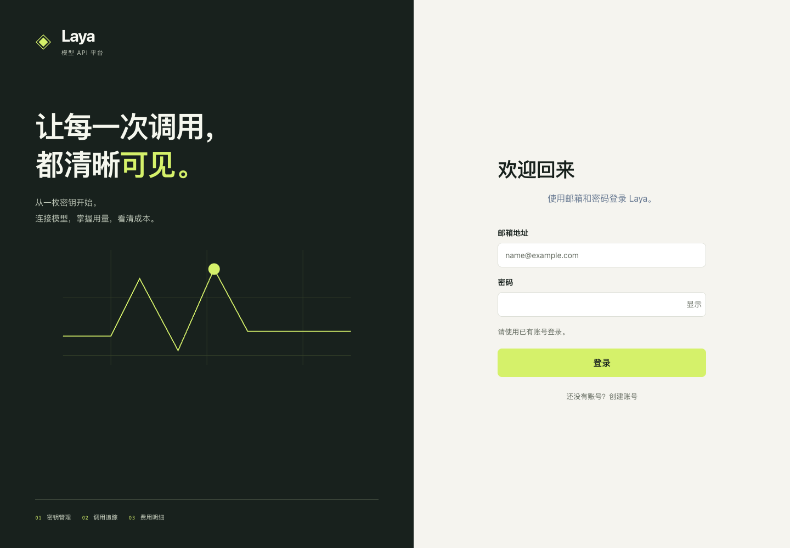

# Vue 前端重做设计

状态：用户确认实施及提交推送，已实施；依据[需求](20261020-Vue前端重做-需求.md)。

## 技术栈与结构

采用：Vue 3 + Composition API / script setup、TypeScript、Vite、Vue Router、Tailwind。
不引入 Axios、Pinia、Element Plus 等额外框架；API 仍使用 fetch，现有样式变量优先复用。
组件测试使用 Vitest + Vue Test Utils + jsdom，类型检查使用 vue-tsc。
安装前查验实际版本及 Node 引擎兼容，安装后更新 package-lock.json，禁止覆盖脚手架整个目录。

```text
frontend/
  index.html                 # 唯一 SPA HTML 入口（已批准替代旧 templetes 规则）
  vite.config.ts
  src/
    main.ts
    App.vue
    router/                  # 路由定义、会话/角色守卫
    layouts/                 # 登录、个人控制台、管理后台布局
    pages/                   # auth、console、admin 业务页面
    components/              # 表格、弹窗、提示、筛选等实际复用组件
    composables/             # 会话、品牌、异步请求等组合逻辑
    api/                     # HTTP/CSRF 与按业务分类的接口函数和类型
    styles/                  # 保留既有视觉 tokens，适配 Vue 组件
  tests/                     # unit、contract、integration、browser
```

这是框架迁移，不是改名：DOM 拼接、手动绑定事件与跨页面状态改由组件模板、响应式状态和
显式生命周期管理。金额仍用字符串展示，前端不重新计算费用；取消/去重请求防止旧筛选结果覆盖新结果。

## 兼容与替换

当前 AGENTS/AI_RULES 规定原生 ES Modules、每模板一个入口、HTML 固定 pages/templetes；
用户提出 Vue 重做使框架约束需要更新。提案改为根 index.html + pages/*.vue，现已确认并同步规则，
不静默保留互相矛盾的两套构建。不改 docs 下任何目录。

按页面分批替换；全量迁移验证后移除被替代的旧页面 HTML、页面 JS、DOM 工具和构建入口，
保留仍复用的纯格式化/数据工具与合成 fixture。旧实现由 Git 保留，不留无期限双入口转发。
删除清单在实施中逐项列明，未确认归属的文件不删除。

## 运行与安全

Vite dev 固定 127.0.0.1:5173 + strictPort，代理到已配置的固定后端；保留 Cookie/CSRF、
错误体、请求 ID、无推理重试/缓存、受控转发头语义。不增加宽泛 CORS 或存储会话 Token。
生产仍构建 dist，由 Nginx 提供；同步 Dockerfile、SPA history fallback、静态资源缓存、
API 路由优先级与健康检查，API 出错不回退到 index.html，未知前端路径有 404 页面。
API_HOST 等已有配置兼容性在实施前核对，不默认对局域网暴露。

## 验证、交付与回滚

已实现命令：npm --prefix frontend ci / run dev / run build / run typecheck / test。
typecheck 与 Vue 单元测试已落地；实际验证见任务记录，不将未配置的 Lint 说成已通过。
保留并适配 test:server 等代理集成测试；浏览器合成环境覆盖所有页面和关键失败路径。
优先使用现有浏览器测试能力；Chrome DevTools MCP 不可用时采用已有 Playwright 运行库，
不得仅以构建通过代替交互验证。无真实业务写入。

首个检查点为 Vue 登录页的浏览器截图及交互，再迁移其余页面。最终报告构建、类型、单元、
代理、浏览器、容器各自验证状态。回滚恢复前端源码、锁文件与容器配置，不涉及 DB 回滚。

官方依据：[Vue 快速开始](https://vuejs.org/guide/quick-start.html)、[Vite 指南](https://vite.dev/guide/)。

登录页样板：
